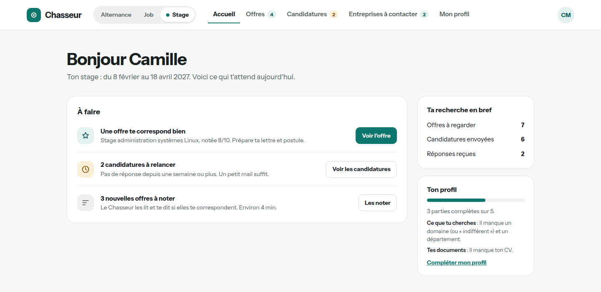
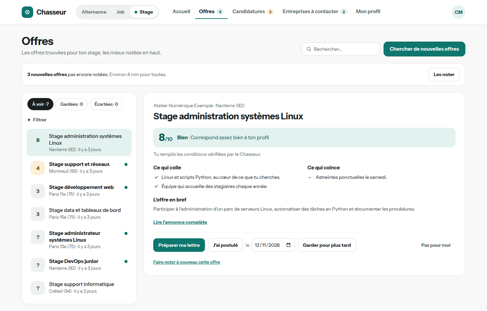
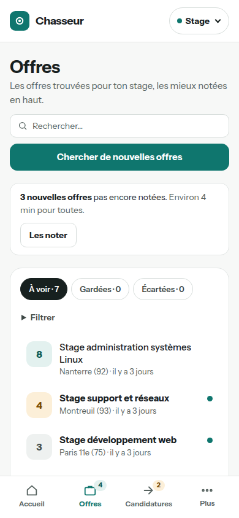

# Chasseur

Chasseur aide les étudiants qui cherchent un stage, une alternance ou un job en Île-de-France : il trouve les offres, les note selon leur profil, prépare leurs lettres et suit leurs candidatures.



## Ce que fait l'app

- **Recherche les offres** sur France Travail et La Bonne Alternance, et des entreprises à contacter sans offre publiée dans la base Sirene de l'INSEE.
- **Note chaque offre** sur 10 avec une IA qui tourne sur la machine, et dit ce qui colle et ce qui coince avec le profil.
- **Écarte les offres inaccessibles** par des règles écrites en Python (niveau d'études, durée, dates, type de contrat), avant toute IA.
- **Prépare la lettre de motivation** : la lettre type de la personne, avec un paragraphe rédigé pour chaque offre, modifiable, puis un PDF.
- **Suit les candidatures** dans un tableau en colonnes (envoyée, relancée, entretien, réponse) et envoie les candidatures spontanées depuis le compte mail de chacun.
- **Accueille plusieurs utilisateurs**, sur invitation : chacun a un profil par mode (stage, alternance, job) et ne voit que ses données.



## Comment ça marche

Une recherche récupère les offres et les enregistre sans attendre l'IA. Des règles par mots-clés écartent tout de suite les offres réservées à un public ou hors sujet.
L'IA locale les note ensuite une à une, en différé, après les vérifications faites en Python. Les mieux notées remontent en haut de la page Offres.
La personne garde, écarte ou prépare sa lettre. « J'ai postulé » fait passer l'offre dans le tableau de suivi, qui signale les candidatures à relancer après 7 jours.
L'IA tourne sur la machine avec [Ollama](https://ollama.com) et des modèles open source : le profil et les offres qu'elle lit ne partent vers aucun service extérieur. Sans IA, tout le reste fonctionne.



## Technologies

Python 3.13, FastAPI, SQLAlchemy, Alembic, SQLite, Jinja, JavaScript sans framework, WeasyPrint, Ollama, pytest.

## Installation sur Fedora

1. Installer les paquets système (WeasyPrint a besoin de Pango et Cairo, les lettres utilisent la police Carlito) :
   ```bash
   sudo dnf install -y python3.13 pango cairo git google-carlito-fonts
   ```
2. Récupérer le code et créer l'environnement Python :
   ```bash
   git clone https://github.com/kenzafb/projet_7_chasseur_alternance.git chasseur
   cd chasseur
   python3.13 -m venv venv
   venv/bin/pip install -r requirements.txt
   ```
3. Créer le fichier de configuration :
   ```bash
   mkdir -p data
   cp .env.example .env
   venv/bin/python -c "import secrets; print(secrets.token_urlsafe(48))"
   ```
   Dans `.env`, renseigner `SECRET_KEY` avec la valeur affichée, choisir un `CODE_INVITATION`, et vider `DATABASE_URL` (la base ira dans `data/chasseur_v2.db`). Pour envoyer des mails, ajouter une `CLE_CHIFFREMENT` :
   ```bash
   venv/bin/python -c "from cryptography.fernet import Fernet; print(Fernet.generate_key().decode())"
   ```
   Pour chercher des offres et des entreprises, il faut aussi les clés des sources (France Travail, La Bonne Alternance, Sirene). Toutes les variables sont décrites dans [docs/CONFIGURATION.md](docs/CONFIGURATION.md).
4. Créer la base :
   ```bash
   venv/bin/alembic upgrade head
   ```
5. Installer l'IA locale et ses deux modèles (facultatif : `ANALYSE_IA=false` dans `.env` pour s'en passer) :
   ```bash
   curl -fsSL https://ollama.com/install.sh | sh
   ollama pull ministral-3:3b
   ollama pull ministral-3:8b
   ```
6. Lancer l'application, puis ouvrir http://localhost:5002 :
   ```bash
   venv/bin/uvicorn main:app --port 5002
   ```

## Premiers pas

1. Créer un compte sur `/register` avec le code d'invitation.
2. Choisir un mode : stage, alternance ou job. Chacun a son profil et ses offres.
3. Remplir Mon profil, partie par partie : chaque partie dit ce qui lui manque.
4. Sur la page Offres, cliquer sur « Chercher de nouvelles offres », puis « Les noter ».

Pour les candidatures spontanées, configurer un compte d'envoi dans Paramètres. Il démarre en mode essai : les mails arrivent dans la boîte de l'utilisateur, pas chez les entreprises, tant que le mode essai n'est pas coupé.

## Administration

- Réinitialiser un mot de passe oublié (un mot de passe temporaire s'affiche, à changer à la connexion suivante) : `venv/bin/python scripts/reinitialiser_mot_de_passe.py prenom@exemple.fr`
- Vérifier l'API France Travail avec ses identifiants : `venv/bin/python scripts/verifier_france_travail.py`
- Vérifier l'API La Bonne Alternance : `venv/bin/python scripts/verifier_lba.py`
- Vérifier l'API Sirene : `venv/bin/python scripts/verifier_sirene.py`
- Vérifier l'IA locale et ses modèles : `venv/bin/python scripts/verifier_ia_locale.py`

## Tests

Plus de 1200 tests, sans appel réseau ni à l'IA (sources et IA simulées) :

```bash
venv/bin/pip install -r requirements-dev.txt
systemd-run --user --scope -p MemoryMax=2G venv/bin/python -m pytest -q
```

## Organisation du code

```
main.py       création de l'application et inclusion des routeurs
routes/       routes par domaine : pages, accueil, offres, lettre, candidatures, profil...
auth/         connexion, inscription, sessions, contrôle de l'origine des requêtes
offres/       recherche France Travail et La Bonne Alternance, notation par l'IA
lettres/      lettre de motivation : rédaction et PDF
spontanees/   entreprises à contacter : Sirene, recherche des emails, envoi
shared/       configuration, client d'IA, règles et référentiels
database/     modèles SQLAlchemy et accès aux données
alembic/      migrations du schéma
templates/    pages Jinja
static/       CSS, JavaScript, police Carlito
scripts/      administration et vérification des API
tests/        suite pytest
docs/         décisions, sources, maquettes, configuration
```

## Documentation

- [docs/DECISIONS.md](docs/DECISIONS.md) : toutes les décisions du projet, numérotées.
- [docs/SPEC_SOURCES.md](docs/SPEC_SOURCES.md) : comportement des API France Travail, La Bonne Alternance et Sirene.
- [docs/maquettes/DESIGN.md](docs/maquettes/DESIGN.md) : principes de l'interface.
- [docs/CONFIGURATION.md](docs/CONFIGURATION.md) : toutes les variables du fichier `.env`.

## Limites et suite

- L'application tourne en local, sur une machine : elle n'est pas hébergée.
- Début janvier 2027, vérifier la recherche Sirene après la bascule automatique vers la nomenclature NAF 2025 (`scripts/verifier_sirene.py`).
- Pistes : un hébergement pour un petit groupe, des notifications (nouvelles offres bien notées, candidatures à relancer).

## Autrice

Kenza Filali-Bouami, [github.com/kenzafb](https://github.com/kenzafb).
